# Architecture and request flow

The workspace contains two applications that communicate over HTTP:

- **Frontend:** static HTML and CSS with TypeScript compiled to browser
  JavaScript. Page scripts call backend APIs with `fetch`.
- **Backend:** an Express and TypeScript API. Routers direct requests to
  controllers, business services, and MySQL data-access code.
- **Database:** the MySQL schema is defined in `backend/db.sql`.

## Request flow

```mermaid
flowchart LR
    Browser["Browser"]
    HTML["Frontend HTML and CSS<br/>frontend/public"]
    PageTS["Page TypeScript<br/>frontend/src"]
    Compiled["Compiled page JavaScript<br/>frontend/public/js"]
    FrontService["Frontend service<br/>fetch() API calls"]
    Router["Express router<br/>/api/..."]
    Controller["Controller<br/>HTTP request and response"]
    Business["Business service and models"]
    DataAccess["Data interface and data models"]
    Pool["MySQL connection pool"]
    Database[("MySQL<br/>3webshop")]

    Browser --> HTML
    HTML --> Compiled
    PageTS -. "compiled by TypeScript" .-> Compiled
    Compiled --> FrontService
    FrontService -- "HTTP request" --> Router
    Router --> Controller
    Controller --> Business
    Business --> DataAccess
    DataAccess --> Pool
    Pool --> Database
    Database -- "query result" --> Pool
    Pool --> DataAccess
    DataAccess --> Business
    Business --> Controller
    Controller -- "JSON response" --> FrontService
    FrontService --> Browser
```

The backend's login endpoint is `POST /api/user/login`. The backend mounts the
user router at `/api/user`; that router passes `/login` to the user controller.
The controller uses the user service to look up the account and returns a JSON
response. The frontend has a corresponding request in `src/login.ts`, but its
current HTML/compiled-script wiring needs the corrections listed in
[Common problems](./start-project.md#common-problems) before the page can submit
that request.

## Backend layers

| Location | Responsibility |
| --- | --- |
| `backend/src/server.ts` | Loads environment configuration, configures Express and CORS, mounts API routers, serves uploaded files, and starts the server. |
| `backend/src/routers/` | Defines API paths and connects them to controller operations. |
| `backend/src/controllers/` | Handles HTTP input and output, and calls business services. |
| `backend/src/business/service/` | Implements application operations using data-access interfaces. |
| `backend/src/business/model/` | Defines business/domain objects used by services. |
| `backend/src/data/Interface/` | Provides data-access interfaces and MySQL-backed implementations. |
| `backend/src/data/models/` | Contains database-facing models and queries. |
| `backend/src/util/database.ts` | Configures the MySQL connection pool. |
| `backend/src/middlewares/` | Contains shared Express middleware such as request logging. |
| `backend/uploads/` | Stores uploaded files served under the `/uploads` URL path. |

## Frontend areas

| Location | Responsibility |
| --- | --- |
| `frontend/public/` | Static HTML pages and their CSS, images, and browser JavaScript. |
| `frontend/src/` | TypeScript page logic, compiled into `public/js/`. |
| `frontend/src/service/` | Shared HTTP/API operations called by page scripts. |
| `frontend/src/types/` | TypeScript types for data exchanged with the API. |
| `frontend/src/shared/` | Shared frontend UI behavior such as navigation and sidebars. |

## API entry points

`backend/src/server.ts` mounts the routers at these prefixes:

| Prefix | Feature |
| --- | --- |
| `/api/user` | User account and login operations |
| `/api/products` | Products |
| `/api/categories` | Categories |
| `/api/cart` | Shopping cart |
| `/api/wishlist` | Wishlist |
| `/api/orders` | Orders |
| `/api/promotion` | Promotions |
| `/api/promotion-products` | Promotion/product links |
| `/api/contact` | Contact requests |
